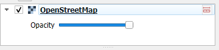
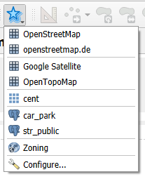
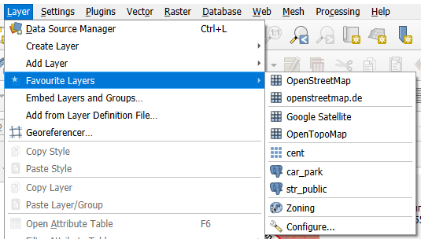
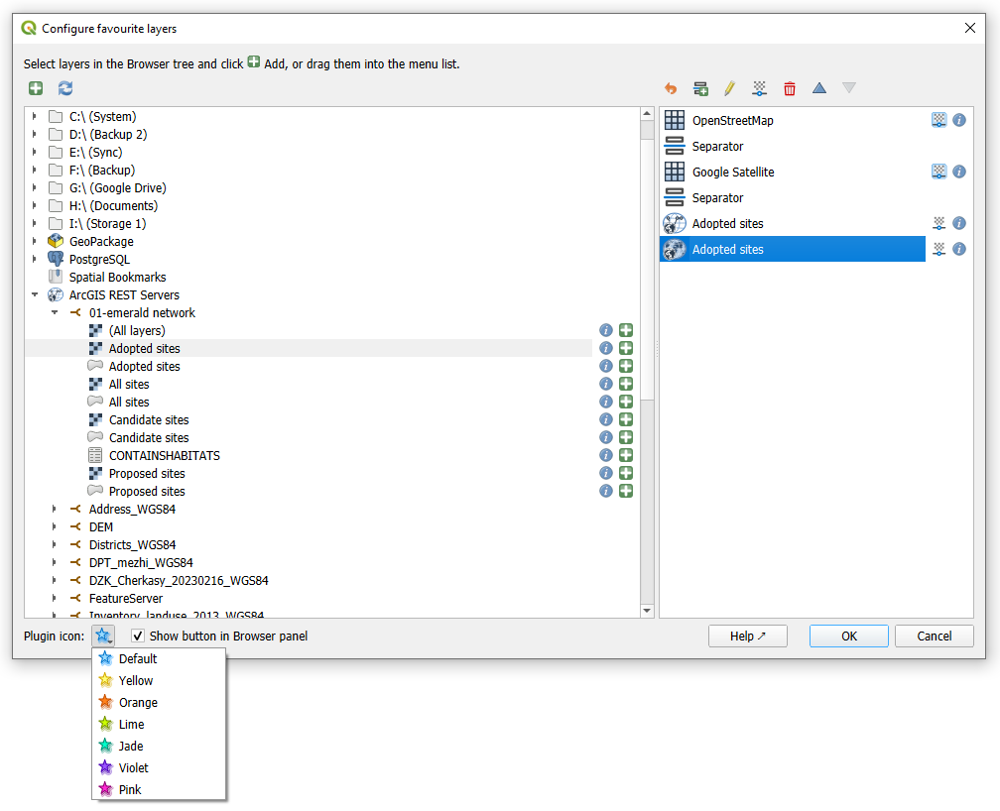

# Favourite Layers

<p align="center">
  
</p>

<p align="center">
  QGIS plugin for quickly adding favorite Browser layers to the current project.
</p>

<p align="center">
  
  
</p>

## Supported Versions

- QGIS minimum version: 3.16
- QGIS maximum version: 4.+
- Compatible with QGIS 3.x on Qt5 and prepared for QGIS 4.x on Qt6.

## Features

- Custom QGIS toolbar with one icon button and a drop-down menu.
- The same **Favourite Layers** menu is also added as an item in the QGIS **Layer** menu.
- Each favourite layer action uses a QGIS layer-type icon.
- Menu separators can be added and reordered in the settings dialog.
- The last menu item opens the settings dialog.
- Settings dialog has a menu list and a filtered QGIS Browser layer tree.
- Layers can be added by the plus icon button or by dragging Browser layer items into the menu list.
- Each favourite layer can add a transparency slider to the Layers panel when it is added to the map.
- The favourite list is stored with `QgsSettings`, so every QGIS user profile keeps its own list.
- If plugin settings are missing, a default OpenStreetMap XYZ tile layer is added to the menu.

## Installation

You may install the plugin from the ZIP package stored in the repository folder:

```text
repo/favourite_layers.zip
```

In QGIS:

1. Open **Plugins > Manage and Install Plugins...**.
2. Open **Install from ZIP**.
3. Select `repo/favourite_layers.zip`.
4. Click **Install Plugin**.
5. Enable **Favourite Layers** if QGIS does not enable it automatically.

After installation, the plugin adds:

- a **Favourite Layers** toolbar button with a drop-down menu;
- a **Favourite Layers** submenu in the QGIS **Layer** menu.

## Updating local QGIS profiles

Use the profile updater from the project directory:

```powershell
python -B repo/restore.py
python -B scripts/sync_to_qgis_profiles.py --dry-run
python -B scripts/sync_to_qgis_profiles.py
```

By default, only existing Favourite Layers installations in QGIS3 and QGIS4
profiles are updated. Use `--profile default` to select that profile, or select
another existing profile explicitly to install the plugin there for the first
time. Use `--profiles-root PATH` for a custom profiles directory.

The updater rejects stale packages, verifies installed file hashes and keeps
previous copies under `<profile>/plugin-backups/favourite_layers/`. A failure
rolls back all profiles in the current batch. `--backup-root PATH` changes the
backup location; it must be on the same filesystem as the plugin directories.
QGIS settings and the saved favourite list are not changed.

Updates are allowed while QGIS is running. Restart QGIS or reload the plugin
afterwards so the updated Python code is loaded.

## Transparency Slider



The transparency slider is configured separately for every favourite layer:

1. Open the plugin settings.
2. Select a layer in the menu list on the right.
3. Enable **Add transparency slider when the layer is added** using either the
   toggle button in the layer row or the matching toolbar button after
   **Rename**.
4. Save the settings and add the layer from the plugin menu.

When enabled, the plugin adds the layer together with an embedded transparency
slider in the QGIS **Layers** panel. The slider changes the layer opacity
directly.

## Screenshots

Favourite Layers toolbar menu:



Favourite Layers submenu in the QGIS Layer menu:



Settings dialog:



## License

MIT License. See `LICENSE`.
